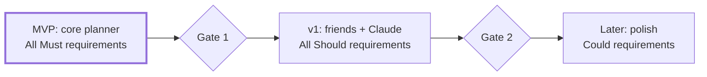

# Laidout — Product Requirements (PRD)

Nov 1, 2026 · @yash

## 1. Overview

Laidout (working name) is a second brain: everything on a person's mind, laid out in a structured way with almost no effort. It is organised by **departments** (areas of life). It lets one person capture, plan and tick off everything in under 10 seconds a time, from the app, by voice, or from any Claude chat.

### Problem

A student juggling classes, a society, placement prep, an internship and side projects spreads tasks across notes apps, WhatsApp, calendars and memory. Generic to-do apps flatten everything into one list or one project tree. They punish missed days with a growing overdue pile, and adding a task takes too many taps. The result is that the planner gets abandoned within weeks.

### Vision

One place that mirrors how the user's life is actually divided, that forgives missed days, and that is faster to use than not using it.

### Goals

1. **Low friction:** adding a to-do takes one sentence; ticking one takes one tap; the daily routine takes under 2 minutes.
2. **Structure that matches life:** departments, each with its own colour, schedule and weekly goals.
3. **Forgiving:** unfinished one-off tasks carry forward automatically; missed habits do not pile up.
4. **Available everywhere:** phone and laptop as equal first-class targets (installable on phones), and inside Claude chats through a connector.
5. **Private and multi-user:** the owner plus a handful of invited friends, each with fully isolated data.
6. **Portfolio quality:** built and understood end to end by the owner, with production practices (tests, CI, monitoring, security).

### Non-goals (v1)

- Team collaboration, shared lists or assigning tasks to others.
- Public sign-up, billing or a marketing site.
- Native iOS/Android apps in v1. A native app on the same backend is a possible later phase (section 9).
- Full offline editing (read-only offline is a stretch goal).
- Calendar sync with Google/Outlook (later version).
- Time tracking, Pomodoro or detailed project management (subtasks, dependencies, Gantt).

### A living document

This PRD describes the current plan, not the final product. Features will be added, removed and reprioritised, and the UI will improve as the build progresses. The rules for changing it:

1. Every change starts as a GitHub issue (label `spec-change`) that says what changes and why.
2. The PRD is updated in the same pull request that implements the change, or before it.
3. Removed requirements keep their ID, marked "Removed" with the date and reason; IDs are never reused.
4. Each change gets one line in the change log (section 11).

## 2. Users and use cases

The primary user is the owner; secondary users are up to about 10 invited friends with similar lives.

| Persona | Who | Needs most |
| --- | --- | --- |
| Owner (primary) | CSE student, society co-president, placement prep, internship, side projects | One view across all departments; quick capture by voice; Claude can read and add tasks |
| Invited friend | Student or young professional, invited by email | Simple onboarding; their own departments; nothing visible to others |
| Admin (the owner, wearing a second hat) | Manages the invite list and the deployment | Add or remove invited emails; see errors; control AI cost |

### Key use cases

1. **Morning check (1 min):** open the app on the phone, see today's list across departments including carried-over items, snooze what won't happen.
2. **Capture on the go (10 s):** tap the mic, say "MUNSoc: send delegation list by Wednesday, LeetCode two mediums every weekday", review, save.
3. **Capture from Claude:** in a Claude chat about exam prep, say "add these study tasks to my planner for this week".
4. **Weekly planning (10 min, Sunday):** set one to three goals per department for the coming week; glance at the month's important dates.
5. **Day-of focus:** use the Focus view as a single checklist for today.
6. **Ask for status:** ask Claude "what's left for today?" or "what did I finish this week in Placement Prep?".
7. **Customise:** add a department for a new internship, hide "College Studies" on Sundays, switch to dark mode.

## 3. Core concepts and glossary

These terms are used with exactly these meanings across the PRD, TRD, UI copy and code.

| Term | Meaning |
| --- | --- |
| Department | A user-defined area of life (e.g. MUNSoc). Has a name, a colour from a fixed palette, an order, an optional link and optional hidden weekdays. |
| Item | Anything placed in the planner. Belongs to exactly one department. Is either a to-do or an event. |
| To-do | A tickable item. Done or not done; records when it was done. |
| Event (important date) | A non-tickable dated item such as an exam or deadline. Shown in Month view and on its day. |
| Dated item | An item with a calendar date. |
| Anytime item | A to-do with no date. Shown in an "Anytime" group until done or given a date. |
| Carry-over | An unfinished one-off to-do whose date is in the past. It appears on today, labelled with its original date, until it is done, snoozed or deleted. |
| Snooze | Moving a to-do in one tap to Tomorrow, Next week (next week's first day) or Anytime. |
| Repeat rule | A stored rule that generates to-dos: daily, weekdays (Mon–Fri) or chosen weekdays, with a start date and optional end date. |
| Occurrence | The to-do a repeat rule produces for one date. Occurrences never carry over. |
| Weekly goal | A short outcome for one department for one week (1–3 per department). Tickable. |
| Today | The current date in the user's chosen timezone, not the server's. |
| Source | Where an item was created: app, AI quick-add or the Claude connector. |

## 4. Functional requirements

There are 55 requirements: 24 Must (the MVP), 22 Should (v1) and 9 Could (later). Each ID is referenced by the TRD, tests and commits (e.g. `feat(plan): carry-over [PLAN-1]`).

### 4.1 Accounts and access

| ID | Requirement | Priority | Acceptance criteria |
| --- | --- | --- | --- |
| AUTH-1 | Sign in with an emailed magic link or 6-digit code; no passwords. | Must (MVP) | An invited email receives a link within 1 min; opening it lands on the planner; the session lasts 30 days on that device. |
| AUTH-2 | Only invited emails can use the app. | Must (MVP) | A non-invited email sees "This planner is invite-only" and can read or write no data, even via direct API calls. |
| AUTH-3 | Sign out on this device. | Must (MVP) | After sign-out, the planner URL redirects to sign-in. |
| AUTH-4 | The admin adds and removes invited emails. | Should (v1) | v1 through the database console; a removed user loses access on their next request. |
| AUTH-5 | Delete my account and all my data. | Should (v1) | One confirmed action removes every row the user owns; signing in again starts onboarding. |
| AUTH-6 | Export my data as JSON. | Could (later) | The download contains all departments, items, rules, goals and settings. |

### 4.2 Onboarding

| ID | Requirement | Priority | Acceptance criteria |
| --- | --- | --- | --- |
| ONB-1 | First run: pick starting departments from presets or type custom ones; timezone is detected. | Must (MVP) | A new user reaches a usable Day view in under 60 s. |
| ONB-2 | Empty states explain the next action ("Add your first to-do"). | Should (v1) | Every view has a designed empty state. |

### 4.3 Departments

| ID | Requirement | Priority | Acceptance criteria |
| --- | --- | --- | --- |
| DEPT-1 | Create a department with a name (1–40 characters) and a colour from a 10-colour palette; at most 20 per user. | Must (MVP) | It appears in every view immediately; the 21st is refused with a clear message. |
| DEPT-2 | Rename and recolour. | Must (MVP) | Changes show in all views without reload. |
| DEPT-3 | Reorder departments. | Must (MVP) | Order persists across devices; up/down buttons in MVP, drag later. |
| DEPT-4 | Delete a department with confirmation. | Must (MVP) | The dialog shows how many items, rules and goals will be deleted; all are removed. |
| DEPT-5 | Hide a department on chosen weekdays. | Should (v1) | Hidden in Day and Focus on those weekdays; its items still exist and show in Week and Month. |
| DEPT-6 | Attach an optional link (e.g. a Drive folder). | Could (later) | The link opens in a new tab from the department header. |

### 4.4 Items

| ID | Requirement | Priority | Acceptance criteria |
| --- | --- | --- | --- |
| ITEM-1 | Add a to-do with text (1–300 characters), a department and an optional date. | Must (MVP) | It shows instantly (under 100 ms perceived) and persists after reload. |
| ITEM-2 | Add an event (important date); a date is required. | Must (MVP) | It shows on its day and in Month view's upcoming list. |
| ITEM-3 | Tick or untick a to-do in one tap. | Must (MVP) | The visual change is immediate; done time is recorded; it survives reload. |
| ITEM-4 | Edit text, date, department and kind. | Must (MVP) | Edits sync to other open devices. |
| ITEM-5 | Delete an item. | Must (MVP) | It disappears from every view. |
| ITEM-6 | Undo a delete or tick for 5 s. | Should (v1) | An undo toast restores the exact previous state. |
| ITEM-7 | Done items stay visible, struck through, on the day they were done; done items can be collapsed. | Should (v1) | Toggling "Hide done" is remembered per device. |

### 4.5 Planning logic

| ID | Requirement | Priority | Acceptance criteria |
| --- | --- | --- | --- |
| PLAN-1 | Carry-over: unfinished one-off to-dos dated before today appear on today, labelled with their original date. | Must (MVP) | An item dated yesterday shows today as "from Sat, 31 Oct"; ticking it marks the original item done; no copy is created. |
| PLAN-2 | Past days show their own items only; carry-over appears only on today. | Must (MVP) | Viewing a past day never shows items from earlier days. |
| PLAN-3 | Snooze a to-do to Tomorrow, Next week or Anytime in one tap. | Must (MVP) | The item moves and its carry-over label disappears. |
| PLAN-4 | Create a repeat rule: daily, weekdays or chosen weekdays, with a start date (default today) and optional end date. | Must (MVP) | "Gym every Mon, Wed, Fri" produces to-dos only on those days. |
| PLAN-5 | Missed occurrences never carry over. | Must (MVP) | A daily habit missed for 3 days shows once today, not 4 times. |
| PLAN-6 | Editing a rule changes future occurrences only. | Should (v1) | Past done/undone states are unchanged. |
| PLAN-7 | Stop a repeat (ends today) or delete it with its future occurrences. | Must (MVP) | Past occurrences remain in history. |
| PLAN-8 | No duplicate occurrences, even with two devices open. | Must (MVP) | Opening the same day on two devices at once yields exactly one to-do per rule per date. |
| PLAN-9 | Weekly goals: 1–3 per department per week, tickable and editable. | Must (MVP) | A 4th goal is refused; goals belong to the week that contains their Monday. |
| PLAN-10 | Copy unfinished goals into next week in one tap. | Could (later) | Copied goals are new rows; originals stay unfinished. |

### 4.6 AI quick-add

| ID | Requirement | Priority | Acceptance criteria |
| --- | --- | --- | --- |
| AI-1 | One sentence of natural language becomes a list of drafts (department, text, date, kind, repeat). | Should (v1) | "MUNSoc meeting Tuesday, gym every weekday" gives 2 correct drafts; p95 response under 4 s. |
| AI-2 | Review before saving: each draft can be edited or removed; nothing saves until Confirm. | Should (v1) | Cancelling saves nothing. |
| AI-3 | Voice input through a mic button: the browser records audio and the server transcribes it, so it works in the iPhone home-screen app as well as on laptops. | Should (v1) | Works on iPhone (home-screen app and Safari), Android, and laptop browsers; the transcript appears in the box for editing within 3 s of stopping; typing and keyboard dictation always work. |
| AI-4 | Relative dates ("tomorrow", "by Wed", "next Friday") resolve in the user's timezone. | Should (v1) | Tested against a fixed "today" for 20 phrases. |
| AI-5 | If AI fails, offer "Add as a plain to-do". | Should (v1) | No input is lost on error. |
| AI-6 | Per-user limits: 20 requests a minute, 200 a day; a global monthly spend cap. | Should (v1) | Over a limit, a friendly message appears and no API call is made. |

### 4.7 Claude connector

| ID | Requirement | Priority | Acceptance criteria |
| --- | --- | --- | --- |
| MCP-1 | Create, view once, and regenerate a personal connector credential in Settings. | Should (v1) | Regenerating stops the old one working within 1 min. |
| MCP-2 | Tools: today's overview, list items, add items (batch), update item (tick, move, edit), delete item, add and list goals. | Should (v1) | Each tool works from a claude.ai chat. |
| MCP-3 | Items added through Claude show in the open app within 2 s, tagged as from Claude. | Should (v1) | Verified with the app open on a phone. |
| MCP-4 | The connector only ever reads or writes its owner's data. | Should (v1) | A test with two users proves no cross-user access. |
| MCP-5 | OAuth sign-in for the connector instead of a secret link. | Could (later) | claude.ai connects through a consent screen. |

### 4.8 Settings, sync and platform

| ID | Requirement | Priority | Acceptance criteria |
| --- | --- | --- | --- |
| SET-1 | Theme: auto, light or dark. | Must (MVP) | Auto follows the OS; no flash of the wrong theme on load. |
| SET-2 | Choose the start view. | Should (v1) | The app opens on it on every device. |
| SET-3 | Week starts on Monday or Sunday. | Should (v1) | Week and Month views follow it. |
| SET-4 | Compact rows; hide empty departments. | Should (v1) | Both apply instantly. |
| SET-5 | Timezone, auto-detected and editable. | Must (MVP) | "Today" flips at local midnight. |
| SYNC-1 | Changes on one device appear on others within 2 s without reload. | Should (v1) | Two-browser test passes. |
| SYNC-2 | Writes are optimistic, roll back on failure and show an error. | Must (MVP) | With the network blocked, a tick reverts and a toast explains. |
| PWA-1 | Installable on phones with an icon and full-screen display. | Should (v1) | Passes Chrome's installability check. |
| PWA-2 | Opens offline with the last data, read-only. | Could (later) | Airplane-mode test shows cached data and an offline banner. |
| LATER-1 | Daily reminder push notification at a chosen time. | Could (later) | Arrives on an installed phone app. |
| LATER-2 | Streaks for repeat rules. | Could (later) | The streak count resets after a missed occurrence. |
| LATER-3 | Templates (e.g. "Conference week") that add a set of items. | Could (later) | Applying one adds all its items with relative dates. |
| LATER-4 | Import events from Google Calendar. | Could (later) | Read-only import of chosen calendars. |

## 5. Key user flows

These five flows are the core daily and weekly use; each should feel finished in the time shown.

### 5.1 First run (under 60 s)

1. Open the site and enter an email.
2. Not invited: see the invite-only message; flow ends.
3. Invited: get the email, tap the link, land back in the app signed in.
4. Pick departments: preset chips (College Studies, Placement Prep, Personal, Projects, Clubs) plus "Add your own".
5. Confirm the detected timezone.
6. Land on Day view with an empty state pointing at the quick-add box.

### 5.2 Daily routine (under 2 min)

1. Open the installed app; it opens on the chosen start view (default Focus).
2. See today's to-dos grouped by department, carried-over items labelled with their original date, today's repeats, and any event today.
3. Tick what's done; snooze what won't happen today (Tomorrow / Next week / Anytime).
4. Add anything new from the quick-add box.

### 5.3 Quick-add by voice or text (under 15 s)

1. Tap the mic (or type) and say one sentence that may hold several items.
2. Tap Add; drafts appear in under 4 s, each showing department colour, text, date and repeat.
3. Fix any draft inline (change department, date or repeat) or remove it.
4. Tap Save; items appear in their views at once.
5. If AI is unavailable or the limit is reached: a message explains and offers "Add as a plain to-do" to the chosen department.

### 5.4 Using the Claude connector

1. One-time setup: Settings → Claude connector → Create; copy the credential; add it in claude.ai as a custom connector.
2. In any Claude chat: "Add to my planner: DBMS lab record due Friday, MUNSoc meeting Tuesday."
3. Claude calls the overview tool to learn departments, then adds the items and replies with what it added.
4. The open app shows the new items within 2 s, tagged as from Claude.
5. "What's left for today?" returns today's unfinished to-dos, including carry-over.
6. If the credential leaks: Settings → Make a new one; the old one stops working.

### 5.5 Weekly planning (Sunday, about 10 min)

1. Open Week view for next week.
2. Add 1–3 goals per department.
3. Optionally copy last week's unfinished goals (PLAN-10).
4. Check Month view for upcoming events and add any missing deadlines.

## 6. Views and UX requirements

Four views share one header (date navigation, view switcher, quick-add, settings); phone and laptop are equally first-class: one-handed on a 360 px-wide phone, keyboard-driven on a laptop, with every feature (including voice) working and tested on both.

| ID | View | Shows | Interactions |
| --- | --- | --- | --- |
| VIEW-1 | Focus | Everything for today in one list: today's to-dos, carry-over, repeats, today's events, then Anytime. Each row shows a department colour dot. | Tick, snooze, edit; filter to one department. |
| VIEW-2 | Day | One column (desktop) or one stacked section (phone) per department for the chosen date. Departments hidden that weekday are omitted. | Previous/next day, "Today" button, add to a specific department inline. |
| VIEW-3 | Week | Seven days by department, plus 1–3 weekly goals per department and a done count per department. | Tick goals and to-dos; jump to a day. |
| VIEW-4 | Month | A calendar grid with coloured dots per day, plus an "Upcoming important dates" list for the next 60 days. | Tap a day to open Day view; add an event. |
| VIEW-5 | Settings | Theme, start view, week start, timezone, compact rows, hide empty, departments manager, Claude connector, account. | Changes save instantly. |

### UX principles

1. **One tap for the common action.** Ticking is the row's main target; snooze is one tap from a row menu.
2. **Never lose input.** Text in the quick-add box survives errors and navigation.
3. **Calm by default.** No red overdue counts; carry-over is a quiet label, not an alarm.
4. **Colour is never the only signal.** Department names appear alongside colour.
5. **Feedback within 100 ms** for every tap, via optimistic updates.

### States every view must design

- Loading (skeleton rows, not spinners over 300 ms).
- Empty (a sentence and the next action).
- Error (what happened and a retry).
- Offline (a banner; writes are blocked or queued, stated clearly).

### Accessibility (WCAG 2.2 AA)

- Full keyboard use: Tab order, visible focus, shortcuts (`n` new item, `t` today, `1–4` switch view).
- Every control has an accessible name; checkboxes are real checkboxes.
- Text contrast of at least 4.5:1 in both themes.
- Respects reduced-motion settings.
- Touch targets at least 44 × 44 px.

### Responsiveness

- Phone (360–480 px): single column, sticky quick-add at the bottom within thumb reach.
- Tablet (768 px): two columns in Day view.
- Desktop (1024 px and up): all departments side by side in Day view, scrolling horizontally only inside the board.

### Visual design (UI v1)

The first UI must match the prototype in `life-planner-reference.zip` (layout, colours, type, spacing, light and dark themes), using its screenshots and stylesheet as the reference. Departures from the prototype come later, as their own `ui` issues, once the MVP works. The prototype is a reference for look and behaviour only; the code is written from scratch.

## 7. Non-functional requirements

The app must feel instant, never leak one user's data to another, and cost under about ₹500 a month to run at 10 users.

| ID | Area | Requirement |
| --- | --- | --- |
| NFR-1 | Performance | First load on a mid-range phone over 4G: Largest Contentful Paint under 2.5 s. |
| NFR-2 | Performance | Tap feedback under 100 ms (optimistic); server confirmation p95 under 500 ms. |
| NFR-3 | Performance | AI quick-add p95 under 4 s end to end. |
| NFR-4 | Reliability | 99.5% monthly availability (hosted platforms' free/hobby tiers). No data loss on any single failed request. |
| NFR-5 | Reliability | Daily database backups; tested restore at least once before inviting friends. |
| NFR-6 | Privacy | Each user sees only their own data, enforced in the database. The admin does not browse friends' data in normal operation. |
| NFR-7 | Privacy | Note text sent to the AI provider only when the user uses quick-add; stated in a short privacy note in Settings. |
| NFR-8 | Security | OWASP Top 10 reviewed; secrets only in environment variables; connector credentials stored hashed. |
| NFR-9 | Security | Rate limits on sign-in emails, AI calls and connector calls. |
| NFR-10 | Cost | AI spend capped per month in the provider console and in code; alert at 80%. |
| NFR-11 | Maintainability | TypeScript strict; tests for all planning logic; CI blocks merging on failures. |
| NFR-12 | Observability | Errors reported with user ID (not email) and request ID; an uptime check on a health endpoint. |
| NFR-13 | Compatibility | Latest two versions of Chrome, Safari, Edge and Firefox; iOS 17+ and Android 12+. |
| NFR-14 | Accessibility | WCAG 2.2 AA for all views (section 6). |

## 8. Success metrics

Success means the owner still uses it daily after 8 weeks and can explain every part of it in an interview. Targets are measured from the app's own data, with no third-party analytics.

| Metric | Target | How it's measured |
| --- | --- | --- |
| Owner daily use | Opened on 6 of 7 days, for 8 consecutive weeks | Days with at least one tick or add |
| Capture speed | Median time from opening quick-add to saved under 15 s | Timestamps logged on the client (local only) |
| Completion rate | 60% or more of dated to-dos done within 2 days of their date | `done_at` vs `date` |
| Carry-over health | Fewer than 10 items carried over on a typical day | Count at first open each day |
| AI accuracy | 90% of drafts saved without edits | Drafts edited or removed before saving |
| Connector use | Used at least 3 times a week by the owner | Items with source = Claude |
| Friend retention | 3 or more invited friends active in week 4 | Weekly active users |
| Quality | CI green on main; zero known cross-user data bugs; error rate under 1% of requests | CI history, error tracker |
| Learning | Owner can whiteboard the architecture and answer the TRD's "interview questions" without notes | Self-check at each milestone |

## 9. Release plan

The product ships in three phases, and each phase starts only when the gate before it is met. No calendar dates are set yet; milestones are planned around exam windows (ISA-2 from 23 Nov, ESA 4–18 Dec). The TRD maps each phase to build milestones.

| Phase | Scope |
| --- | --- |
| **MVP: core planner** (build now) | Invite-only email sign-in; departments and onboarding; to-dos, events, tick, edit; carry-over and snooze; repeats and weekly goals; all four views; theme and timezone; optimistic updates; CI and tests from day one |
| **Gate 1** | Owner uses it daily for 2 weeks; all Must criteria pass |
| **v1: friends + Claude** | Realtime sync across devices; voice + AI quick-add; Claude connector (MCP); remaining settings; installable PWA; undo and account deletion; error tracking and alerts; custom email and backups; staging environment |
| **Gate 2** | Two-user security tests pass; error rate under 1% for 2 weeks |
| **Later: polish** | OAuth for the connector; read-only offline mode; daily reminder pushes; habit streaks; templates; Google Calendar import; data export (JSON); copy goals to next week; drag to reorder |

Invited friends join only after Gate 1, so the owner has lived with the MVP before anyone else's data is in it.

Work is tracked as GitHub issues. Each phase is a GitHub milestone, each requirement ID becomes one or more small issues, and new ideas go into a `backlog` label until a gate review pulls them into a phase.

**Possible next phase: native mobile app.** If people use the web app daily, a mobile app built with Expo (React Native) can follow as a second client on the same backend. It would add home-screen and lock-screen widgets, Siri/Action Button shortcuts, a share-sheet "Add to planner" and dependable reminders. To keep that door open, all business rules live in shared schemas, database constraints and server endpoints, never only in web components.

## 10. Risks, assumptions and open questions

The biggest risk is scope: building everything by hand while studying means the MVP must stay small enough to finish.

### Risks

| Risk | Impact | Mitigation |
| --- | --- | --- |
| Scope creep delays the MVP | No usable app; motivation drops | Ship Must items only; everything else waits for a gate review |
| Exam periods stall progress | Weeks without commits | Plan milestones around exam windows; keep each milestone under a week of evenings |
| Cross-user data leak | Friends' private data exposed | Row level security on every table plus automated two-user tests |
| AI cost spike or abuse | Unexpected bill | Per-user limits, provider spend cap, alerting |
| AI misreads dates or departments | Wrong items saved | Review-before-save; regression tests on 20+ phrases |
| Connector credential leaks | Someone edits the planner | Hashed storage, one-tap regenerate, OAuth in a later version |
| Free-tier limits (email, database pausing) | Sign-in or app down | Custom SMTP; keep-alive or paid tier before inviting friends |
| Browser speech recognition is uneven (missing in iPhone home-screen apps) | Voice fails on some devices | Record audio and transcribe on the server; typing and the keyboard's own mic always work |

### Assumptions

- Users have one timezone at a time; travel changes are handled by editing the setting.
- Up to about 10 users and a few thousand items each; no sharding or caching layer needed.
- claude.ai custom connectors continue to support remote MCP servers over HTTPS.
- Free or hobby tiers of the chosen hosting are acceptable for availability.

### Open questions

- [ ] Should missed repeats show a quiet "missed" history, or simply disappear?
- [ ] Should carry-over have a cut-off (e.g. older than 14 days moves to Anytime automatically)?
- [ ] Should friends get their own AI limits, or share the owner's monthly cap?
- [ ] Is Next week's first day Monday always, or the user's week-start setting?
- [ ] Should events support a time of day, or stay date-only?
- [ ] Is offline write support (PWA-2 beyond read-only) worth the complexity?

## 11. Change log

Newest first. One line per change to scope, priority or design.

| Date | Change | Issue |
| --- | --- | --- |
| 2026-11-01 | Product named Laidout (working name, may change); positioned as a second brain | — |
| 2026-11-01 | Web app confirmed (Next.js PWA) with phone and laptop both first-class; voice switched to server-side transcription (AI-3); native app added as a possible later phase | — |
| 2026-11-01 | First draft; UI v1 set to match the prototype; GitHub issue workflow added | — |